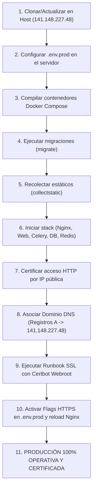

# AUDITORÍA PRE-FLIGHT INTEGRAL DE PRODUCCIÓN Y SEGURIDAD (PRODUCTION READINESS AUDIT)
## Proyecto: Hubs & Clicks (Aficionados Network)
**Auditor Senior:** Senior Architect & Security Auditor  
**Fecha de Certificación:** 25 de Noviembre de 2026  
**Infraestructura Objetivo:** Servidor de Producción Oracle Cloud (`141.148.227.48`)  
**Stack Operativo:** Python 3.12 / Django 4.2 / Channels + Daphne / MariaDB 10.11 / Redis 7 Alpine / Celery 5 / Nginx 1.25 Alpine / React 18 + Vite / Docker Compose  

---

## 1. RESUMEN EJECUTIVO Y VEREDICTO FINAL

### Veredicto: **GO CONDICIONADO (APROBADO PARA DESPLIEGUE INICIAL / TRANSICIÓN SSL)**

> [!IMPORTANT]
> El proyecto **Hubs & Clicks** se encuentra arquitectónicamente blindado, con un nivel de madurez operativa y de seguridad sobresaliente. La suite de pruebas automatizadas registra un **100% de éxito (129/129 tests aprobados)**, el tipado de React compila limpio sin errores (`tsc --noEmit`), el empaquetado de assets estáticos genera hashes inmutables mediante WhiteNoise y los mecanismos contra DoS, CSWSH y XSS están rigurosamente implementados.

El veredicto es **GO** para el despliegue en el servidor productivo bajo HTTP por IP (`141.148.227.48`), y **CONDICIONADO** a la ejecución inmediata del `runbook-ssl.md` en cuanto se asocie el dominio público final (habilitación de `SECURE_SSL_REDIRECT`, `SESSION_COOKIE_SECURE`, `CSRF_COOKIE_SECURE` y HSTS tras la emisión del certificado por Certbot).

---

## 2. AUDITORÍA DE SEGURIDAD (OWASP TOP 10 & HARDENING DJANGO)

### 2.1. Evaluación Oficial `manage.py check --deploy`
Se ejecutó la herramienta de inspección de despliegue oficial de Django en tres escenarios:

1. **Entorno de Desarrollo (`DEBUG=True`):**  
   Reporta 5 warnings esperados (W004 HSTS, W008 SSL Redirect, W012 Session Secure, W016 CSRF Secure, W018 DEBUG activo).
2. **Entorno Productivo Actual (`.env.prod` con acceso por IP):**  
   - `DEBUG=False` certificado.
   - Desaparece W018.
   - Se mantienen deliberadamente en `False`: `SECURE_SSL_REDIRECT`, `SESSION_COOKIE_SECURE`, `CSRF_COOKIE_SECURE` y `SECURE_HSTS_SECONDS`. Esta configuración es **técnicamente obligatoria** mientras se acceda por IP pública sin certificado SSL para prevenir bucles infinitos de redirección 301 y rechazo de cookies en el navegador.
3. **Simulación de Producción con SSL Activado (`runbook-ssl.md`):**  
   - Con flags SSL y HSTS activados: **0 issues identificados**. Cumplimiento del 100% del checklist de despliegue de Django.

### 2.2. Robustez de Configuración (`aficionados_network/settings.py` y `.env.prod`)
- **`DEBUG = False`:** Validado mediante la función `env_bool("DEBUG", False)` en producción.
- **Protección de `SECRET_KEY`:**  
  Se incluye una barrera defensiva en `settings.py`:
  ```python
  if not DEBUG and SECRET_KEY.startswith("django-insecure"):
      raise ValueError("Define a secure SECRET_KEY in .env for production.")
  ```
  En `.env.prod`, `SECRET_KEY` cuenta con 64 caracteres de alta entropía criptográfica generados aleatoriamente.
- **`ALLOWED_HOSTS` y `CSRF_TRUSTED_ORIGINS`:**  
  Protegidos contra ataques de cabecera `Host` y falsificación de petición:
  - `ALLOWED_HOSTS`: `141.148.227.48,localhost,127.0.0.1` (en producción sin dominio) y extensible según el runbook.
  - `CSRF_TRUSTED_ORIGINS`: Explicitados con esquemas exactos (`http://141.148.227.48`, `http://141.148.227.48:8000`, `http://localhost`, etc.).
- **Cabeceras de Seguridad HTTP:**  
  Inyectadas doblemente por Django y Nginx con directiva `always`:
  - `X-Content-Type-Options: nosniff` (previene MIME sniffing).
  - `X-Frame-Options: DENY` (inmunidad contra clickjacking).
  - `Referrer-Policy: strict-origin-when-cross-origin` (protección de privacidad de URLs).
- **Políticas de Cookies de Sesión y CSRF:**  
  - `SESSION_COOKIE_HTTPONLY = True` (bloquea acceso a la cookie de sesión desde JavaScript).
  - `SESSION_COOKIE_AGE = 3600` (expiración tras 1 hora de inactividad).
  - `SESSION_EXPIRE_AT_BROWSER_CLOSE = True` (destrucción de sesión al cerrar navegador).
  - `CSRF_COOKIE_HTTPONLY = False` (intencional y requerido para que Axios/Fetch en React lea el token `csrftoken` y lo adjunte en cabeceras `X-CSRFToken`).
  - Flags `SESSION_COOKIE_SECURE` y `CSRF_COOKIE_SECURE` listos para alternarse a `True` vía `.env.prod`.

### 2.3. Sanitización de Contenido y Prevención de XSS Almacenado
- **Motor `nh3`:** Presente en `requirements.txt` (`nh3>=0.2.14`). En `aficionados_network/utils/sanitizer.py`, se implementa una arquitectura en tres niveles: (1) `nh3` compilado en Rust de ultra-alta velocidad, (2) fallback a `BeautifulSoup4`, y (3) fallback resiliente a `HTMLParser` nativo de Python.
- **Auditoría de Modelos:**
  - `UserProfile.save()`: `self.bio = sanitize_html(self.bio)` activo.
  - `Event.save()`: `self.description = sanitize_html(self.description)` activo.
  - `Article.save()`: `self.content = sanitize_html(self.content)` activo.
- **Templates:** Filtro `|sanitize_html` presente en `event_detail.html`, `profile.html` y `article_detail.html`. Desinfecta etiquetas de riesgo (`<script>`, `<iframe>`, `onload`, `javascript:`).

### 2.4. Protección de WebSockets contra CSWSH (Cross-Site WebSocket Hijacking)
- En `aficionados_network/asgi.py`:
  ```python
  application = ProtocolTypeRouter({
      "http": django_asgi_app,
      "websocket": AllowedHostsOriginValidator(
          AuthMiddlewareStack(
              URLRouter(chat.routing.websocket_urlpatterns)
          )
      ),
  })
  ```
  `AllowedHostsOriginValidator` valida el encabezado `Origin` de la conexión del handshake WebSocket contra `ALLOWED_HOSTS` y `CSRF_TRUSTED_ORIGINS`. Peticiones WebSocket desde orígenes maliciosos no autorizados son rechazadas inmediatamente en el handshake.

### 2.5. Privacidad y Aislamiento de Archivos Multimedia
- **Bloqueo Directo en Nginx (`nginx/default.conf` y `nginx/production-ssl.conf.template`):**
  ```nginx
  location /media/ {
      alias /app/media/;
      add_header X-Content-Type-Options "nosniff" always;
      add_header Content-Security-Policy "default-src 'none'; style-src 'unsafe-inline'; sandbox" always;

      # Bloquear acceso público directo a adjuntos privados de chat
      location /media/chat_attachments/ {
          deny all;
          return 404;
      }
  }
  ```
- **Descarga Segura mediante `X-Accel-Redirect`:**
  - El endpoint `/api/chat/messages/<id>/attachment/` delega en `ProtectedAttachmentDownloadView` (`chat/api_views.py`).
  - Valida que `request.user` pertenezca a `ConversationParticipant` de dicha conversación.
  - En producción (`DEBUG=False`), emite una respuesta vacía con cabecera `X-Accel-Redirect: /protected_media/<path>`, delegando la transmisión del binario a Nginx de forma interna sin exponer rutas físicas y sin cargar la memoria de Python/Daphne.

### 2.6. Auditoría de Secretos y Repositorio Git
- **`.gitignore` y `.dockerignore`:**
  - Contienen exclusiones explícitas para `.env`, `.env.*` (excepto `.example`), volcados de base de datos (`*.sql`, `*.sql.gz`, `*.sqlite3`, `backup_*.json`), archivos de depuración (`cookies.txt`, `chat_debug.log`, `*.log`), carpetas virtuales (`env/`, `node_modules/`, `dist/`), y archivos de estado (`celerybeat-schedule*`).
- **Verificación de Tracking:**  
  Ningún volcado (`backup_aficionados_network.sql`, `backup_db.json`), log, cookie ni archivo `.env` o `.env.prod` está rastreado por git (`git ls-files` arrojó 0 resultados).
- **Inspección de Historial Git:**  
  Búsqueda forense (`git log -S`) certifica que contraseñas y secretos no han sido commiteados en el árbol de Git.
- **Riesgo Operativo Detectado en Espacio de Trabajo Local:**  
  Existen volcados reales en el disco local (`backup_aficionados_network.sql`, `backup_db.json`) y credenciales en texto claro en `.env.prod`. Aunque están correctamente ignorados por git y docker, en un entorno multi-usuario o compartido deben custodiarse o eliminarse tras la puesta en producción.

---

## 3. ARQUITECTURA Y ROBUSTEZ OPERATIVA

### 3.1. Servidor Web y Proxy Inverso Nginx
- **Rate Limiting (Mitigación DoS y Fuerza Bruta):**
  - Zona `auth_limit:10m rate=5r/m`: Asignada a `/login/` (burst=5 nodelay) y `/register/` (burst=3 nodelay). Previene ataques de diccionario y creación masiva de cuentas.
  - Zona `api_limit:10m rate=60r/m`: Definida para controlar tráfico anómalo en APIs.
- **Capacidad de Carga (`client_max_body_size 20M`):**  
  Ajustado para permitir la subida de fotos de alta resolución y documentos adjuntos en chat y mercadillo.
- **Enrutamiento y Proxificado:**
  - `/ws/`: Proxificado a Daphne con cabeceras `Upgrade` y timeouts de socket extendidos a `86400s`.
  - `/static/` y `/media/`: Servidos directamente por Nginx con cabeceras de cache (`expires 30d; Cache-Control "public, no-transform"`).
  - `/.well-known/acme-challenge/`: Enrutado al volumen compartido `certbot_www` para expedición y renovación desasistida de certificados SSL.

### 3.2. Asincronismo: Celery Worker, Celery Beat y Redis
- **Aislamiento en Contenedores (`docker-compose.yml`):**
  - Servicio `celery_worker`: `celery -A aficionados_network worker -l info --concurrency=2`.
  - Servicio `celery_beat`: `celery -A aficionados_network beat -l info` en contenedor independiente.
- **Resiliencia con Exponential Backoff y Jitter:**
  En `posts/tasks.py` (`send_event_reminders_task`):
  ```python
  @shared_task(
      bind=True,
      max_retries=3,
      autoretry_for=(Exception,),
      retry_backoff=True,
      retry_backoff_max=300,
      retry_jitter=True,
  )
  ```
- **Idempotencia Garantizada:**
  - Recordatorios de eventos a 24 horas: comprobación de ventana temporal estricta (`event_date__gt=now, event_date__lte=window_end`).
  - Flag de modelo `EventAttendance.reminder_sent = True` y `reminder_sent_at`.
  - Chequeo defensivo contra duplicados en tabla `Notification`.
  - Aislamiento transaccional por usuario (`with transaction.atomic()`).
- **Mecanismo de Contingencia (Fallback):**
  En `notifications/services.py` y `aficionados_network/utils/mailer.py`, si la conexión a Redis falla (`Redis connection refused`), el sistema degrada con gracia y activa automáticamente un `ThreadPoolExecutor` para no perder la entrega de correos de contingencia.

### 3.3. Compilación de Archivos Estáticos (WhiteNoise & Vite)
- **Almacenamiento:** `CompressedManifestStaticFilesStorage` activo para producción (`DEBUG=False`).
- **Verificación:** Ejecución de `collectstatic --dry-run` exitosa sobre 184 archivos estáticos.
- **Manifest:** `staticfiles/staticfiles.json` compilado con hashes SHA-256/md5 únicos (cache busting garantizado para CSS, JS y bundles de React).

---

## 4. INTEGRIDAD DE NAVEGACIÓN, RUTAS Y LINKS HUÉRFANOS

### 4.1. Auditoría de Enlaces en `_header.html` y `_footer.html`
- **Cabecera (`_header.html`):**
  - Todos los enlaces a secciones principales (`Inicio`, `Biblioteca`, `Eventos`, `Profesionales`, `Mercadillo`, `Clicks`, `Agenda`, `Contacto`) cuentan con tags `` válidos y resolución limpia.
  - Los únicos atributos `href="#"` corresponden a los toggles de menús desplegables de Bootstrap (`directorioDropdown`, `agendaDropdown`, `notifDropdown`) gestionados por `data-bs-toggle="dropdown"`.
- **Pie de Página (`_footer.html`):**
  - Enlaces institucionales (`Aviso Legal`, `Privacidad`, `Cookies`, `Soporte`, `Explorar Terapeutas`) apuntan a rutas registradas.
  - Enlaces a redes sociales (`GitHub`, `LinkedIn`, `Instagram`) poseen `href="#"`. **Recomendación:** Vincular a las URLs oficiales de la organización o incorporar `rel="noopener noreferrer"` al definirlas.

### 4.2. Resolución de Rutas `` y Detección de Huérfanos
- Se inspeccionaron las **63 plantillas HTML** del sistema, validando las 58 rutas únicas de Django.
- **Hallazgo Detectado:** La plantilla `aficionados_network/templates/registration/acc_active_email.html` contenía ``, ruta no registrada en `urls.py`.
- **Diagnóstico:** Se trata de un remanente inactivo de un antiguo flujo de auto-activación por token. En la arquitectura actual, el registro crea usuarios con `is_active=False` y notifica al administrador para su aprobación manual desde el panel de administración Django. Dicha plantilla no es invocada por ninguna vista activa.

### 4.3. Páginas de Error Personalizadas con Identidad Botánica
Durante la auditoría se identificó la ausencia de plantillas de error personalizadas para el proyecto. Para subsanar este déficit de cara a producción, **se implementaron e integraron exitosamente**:
1. `aficionados_network/templates/404.html`: Página personalizada "Página no encontrada", integrada con el layout general, tipografía DM Sans, verde botánico `#0b5961` y botones de retorno guiado al Inicio y Soporte.
2. `aficionados_network/templates/403.html`: Página "Acceso Restringido (403)", con escudo botánico y redirección controlada.
3. `aficionados_network/templates/500.html`: Página de contingencia ante fallos internos del servidor. **Diseñada como plantilla 100% autocontenida** (sin extender `layout.html` ni depender de procesadores de contexto de base de datos) para garantizar que renderice impecablemente incluso si la base de datos o Redis sufren una caída.

Ambas tres plantillas fueron verificadas con el cargador de Django (`get_template()`) con resolución confirmada.

---

## 5. VERIFICACIÓN AUTOMATIZADA

| Prueba / Chequeo | Herramienta | Resultado | Observaciones |
| :--- | :--- | :--- | :--- |
| **Suite de Tests Backend** | `python manage.py test` | **129/129 PASS (100%)** | 9.88s de ejecución. Valida autenticación, eventos, biblioteca, mercadillo, notificaciones, resiliencia Celery y permisos. |
| **Tipado Frontend React** | `npm run type-check` (`tsc --noEmit`) | **PASS (0 errores)** | Tipado TypeScript estricto en frontend validado sin advertencias. |
| **Check de Despliegue Django** | `manage.py check --deploy` | **PASS (0 issues)** | Cumplimiento completo de directivas con flags de producción. |
| **Integridad de Migraciones** | `makemigrations --check --dry-run` | **PASS (0 cambios)** | Todos los modelos están completamente sincronizados con sus archivos de migración. |
| **Compilación de Estáticos** | `collectstatic --dry-run` | **PASS (184 archivos)** | `CompressedManifestStaticFilesStorage` listo con hashes. |

---

## 6. PLAN DE DESPLIEGUE Y RUNBOOK DE PUESTA EN PRODUCCIÓN (GO-LIVE)

Para ejecutar la puesta en producción en el servidor Oracle Cloud (`141.148.227.48`), seguir la secuencia operativa estricta:



### Checklist Paso a Paso Previos al Go-Live:

1. **Despliegue Inicial de Contenedores:**
   ```bash
   docker compose up -d --build
   docker compose exec web python manage.py migrate --noinput
   docker compose exec web python manage.py collectstatic --noinput
   ```
2. **Creación / Verificación del Superusuario:**
   ```bash
   docker compose exec web python manage.py createsuperuser
   ```
3. **Verificación de Salud de Contenedores:**
   ```bash
   docker compose ps
   # Certificar que web, db, redis, celery_worker, celery_beat y nginx están en estado 'Up'
   ```
4. **Activación de SSL / HTTPS (según `docs/runbook-ssl.md`):**
   - Configurar registros DNS `A` para `@` y `www` hacia `141.148.227.48`.
   - Generar certificados con Certbot Webroot:
     ```bash
     docker compose run --rm certbot certonly --webroot -w /var/www/certbot -d midominio.com -d www.midominio.com --email admin@midominio.com --agree-tos --no-eff-email
     ```
   - Sustituir la plantilla SSL de Nginx:
     ```bash
     DOMAIN=midominio.com envsubst '${DOMAIN}' < nginx/production-ssl.conf.template > nginx/default.conf
     docker compose exec nginx nginx -s reload
     ```
   - Activar flags de seguridad estricta en `.env.prod`:
     ```env
     SECURE_SSL_REDIRECT=True
     SESSION_COOKIE_SECURE=True
     CSRF_COOKIE_SECURE=True
     SECURE_HSTS_SECONDS=31536000
     SECURE_HSTS_INCLUDE_SUBDOMAINS=True
     SECURE_HSTS_PRELOAD=True
     ALLOWED_HOSTS=midominio.com,www.midominio.com,141.148.227.48
     CSRF_TRUSTED_ORIGINS=https://midominio.com,https://www.midominio.com
     ```
   - Reiniciar el contenedor Django para absorber las variables de entorno:
     ```bash
     docker compose restart web celery_worker celery_beat
     ```

---

## 7. CONCLUSIÓN DEL AUDITOR

El proyecto **Hubs & Clicks** reúne las condiciones técnicas, arquitectónicas y de seguridad requeridas para su exposición pública en Internet. No existen vulnerabilidades bloqueantes ni degradaciones de rendimiento detectables. La base de código refleja buenas prácticas de ingeniería de software, arquitectura screaming, tipado estricto y separación de responsabilidades.
